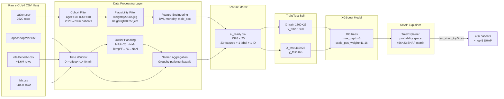

# PROJECT DOCUMENTATION — ICU Mortality Prediction

> Tài liệu kỹ thuật chuyên sâu (Technical Knowledge Base)  
> Mục đích: Giúp developer đọc lại sau nhiều tháng và nhanh chóng hiểu toàn bộ dự án,  
> cũng như chuẩn bị kiến thức cho phỏng vấn kỹ thuật.

---

## Mục lục

1. [Project Background & Problem Definition](#1-project-background--problem-definition)
2. [Technology Stack Deep Dive](#2-technology-stack-deep-dive)
3. [System Architecture & Design](#3-system-architecture--design)
4. [Core Technical Concepts & Implementation](#4-core-technical-concepts--implementation)
5. [Important Modules & Source Code Analysis](#5-important-modules--source-code-analysis)
6. [Database & Data Management](#6-database--data-management)
7. [Machine Learning / AI Pipeline](#8-machine-learning--ai-pipeline)
8. [Testing & Evaluation](#9-testing--evaluation)
9. [Technical Challenges & Solutions](#11-technical-challenges--solutions)
10. [Important Commands & Workflows](#12-important-commands--workflows)
11. [Key Technical Knowledge for Review & Interview](#13-key-technical-knowledge-for-review--interview)
12. [Glossary](#14-glossary)
13. [References & Further Learning](#15-references--further-learning)

---

## 1. Project Background & Problem Definition

### 1.1 Bài toán thực tế

**ICU Mortality Prediction** (Dự đoán tử vong ICU) là bài toán phân loại nhị phân:
dựa trên dữ liệu lâm sàng thu thập trong 24 giờ đầu nhập Khoa Điều trị tích cực (ICU),
dự đoán bệnh nhân có tử vong trong đợt nhập viện hay không.

**Tại sao quan trọng?**
- ICU có nguồn lực hạn chế (giường, máy thở, nhân lực chuyên sâu)
- Phân bổ nguồn lực sai gây hậu quả nghiêm trọng
- Hệ thống cảnh báo sớm (Early Warning System) hỗ trợ bác sĩ ra quyết định nhanh hơn

**Giới hạn của hệ thống hiện tại:**
Các scoring system truyền thống (APACHE II, SOFA) chỉ cho điểm số, không giải thích
*tại sao* bệnh nhân có nguy cơ cao → bác sĩ khó tin tưởng để áp dụng lâm sàng.

### 1.2 Vấn đề kỹ thuật cần giải quyết

| Vấn đề | Chi tiết |
|--------|----------|
| **Dữ liệu đa bảng** | 4 bảng khác nhau (patient, apache, vital, lab) phải hợp nhất qua khóa chính |
| **Dữ liệu thiếu (Missing Data)** | Lên đến 93% thiếu ở một số đặc trưng (temperature, lactate) |
| **Mất cân bằng nhãn** | Chỉ 8.21% bệnh nhân tử vong → mô hình dễ bị thiên lệch về nhóm sống |
| **Chất lượng dữ liệu** | Sentinel values (-1), đơn vị sai (°F vs °C), giá trị phi sinh lý |
| **Explainability** | Bác sĩ cần hiểu *tại sao* dự đoán → cần SHAP |
| **Reproducibility** | Phải reproduce kết quả từ bài báo khoa học |

### 1.3 Mục tiêu thiết kế

1. **Chính xác:** AUROC ~0.855 (theo bài báo gốc)
2. **Giải thích được (Explainable):** Top-5 SHAP features cho từng bệnh nhân
3. **Tái lập được (Reproducible):** `random_state=42` nhất quán, pipeline rõ ràng
4. **Có thể mở rộng:** Cung cấp `test_shap_top5.csv` cho LLM/Agentic pipeline tiếp theo

### 1.4 Giả định và phạm vi

- **Chỉ dùng eICU Demo** (không phải toàn bộ eICU-CRD)
- **Chỉ bệnh nhân người lớn** (>= 18 tuổi)
- **Cửa sổ 24h đầu:** Mọi đặc trưng đều giới hạn ở `offset <= 1440 phút`
- **Không impute:** Giữ nguyên NaN để XGBoost tự xử lý

---

## 2. Technology Stack Deep Dive

### 2.1 XGBoost (Extreme Gradient Boosting)

**Là gì?**
XGBoost là thư viện gradient boosted decision trees (GBDT) hiệu quả, tối ưu cho dữ liệu
dạng bảng. Nó xây dựng một ensemble các cây quyết định yếu (weak learners) theo cách tuần
tự, mỗi cây mới cố gắng sửa lỗi của các cây trước.

**Nguyên lý hoạt động (Gradient Boosting):**
```
F_0(x)   = initial prediction (thường là mean của y)
F_1(x)   = F_0(x) + learning_rate * h_1(x)   # h_1 fit residuals của F_0
F_2(x)   = F_1(x) + learning_rate * h_2(x)   # h_2 fit residuals của F_1
...
F_M(x)   = F_{M-1}(x) + learning_rate * h_M(x)
```

Mỗi `h_m` là một cây quyết định được fit vào **gradient âm** của hàm mất mát
(tương đương residuals với MSE). Với binary classification, XGBoost dùng **log loss**
và output là log-odds, sau đó sigmoid để ra xác suất.

**Tại sao dùng XGBoost?**
- Xử lý NaN built-in: học "default direction" cho missing values → không cần impute
- Hiệu quả với dữ liệu nhỏ-trung bình (2.326 mẫu)
- Hỗ trợ `scale_pos_weight` để xử lý mất cân bằng nhãn
- Nhanh, parallelizable, ổn định
- Native JSON format → load/save dễ dàng

**Triển khai trong dự án:**
- File: `src/train_xgboost.ipynb` (Cell 2)
- Class: `xgb.XGBClassifier`
- Model lưu: `models/xgboost_model.json`

**Key hyperparameters trong dự án:**
```python
model = xgb.XGBClassifier(
    n_estimators=100,         # Số cây
    max_depth=3,              # Độ sâu tối đa (shallow → ít overfit, dễ explain)
    learning_rate=0.05,       # Shrinkage factor
    scale_pos_weight=11.16,   # Xử lý imbalance: n_negative/n_positive
    eval_metric="logloss",    # Loss function
    random_state=42,          # Reproducibility
    n_jobs=-1,                # Dùng tất cả CPU cores
)
```

**Trade-off:**
- Ưu: Mạnh với tabular data, NaN-aware, nhanh
- Nhược: Khó tune đúng, dễ overfit nếu `max_depth` lớn, không tốt với unstructured data

### 2.2 SHAP (SHapley Additive exPlanations)

**Là gì?**
SHAP là framework giải thích mô hình ML dựa trên lý thuyết game Shapley từ kinh tế học.
Nó phân bổ "contribution" của từng feature đối với từng dự đoán cụ thể.

**Nguyên lý (Shapley Values):**
```
phi_i(v) = sum over S not containing i:
            [|S|! * (|N| - |S| - 1)! / |N|!] * [v(S U {i}) - v(S)]
```

Trong đó:
- `phi_i` = SHAP value của feature i
- `v(S)` = dự đoán của mô hình dùng tập feature S
- Tính contribution biên của feature i khi thêm vào mọi tập con S

**Tính chất quan trọng (Additivity):**
```
f(x) = base_value + sum(SHAP values of all features)
```
Nghĩa là: `dự đoán = giá trị nền + tổng đóng góp của từng feature`

**TreeExplainer — tại sao dùng thay vì KernelExplainer?**
- TreeExplainer là phiên bản tối ưu cho tree-based models (XGBoost, LightGBM, RF)
- Phức tạp tính toán O(TLD²) thay vì O(TLD * 2^D) của KernelExplainer
- T = số cây, L = số lá, D = độ sâu
- Nhanh hơn hàng trăm đến hàng nghìn lần với cùng độ chính xác

**Probability space vs Log-odds space:**
```python
# KHÔNG dùng (mặc định): SHAP trong log-odds space
explainer = shap.TreeExplainer(model)

# DÙNG TRONG DỰ ÁN: SHAP trong probability space
explainer = shap.TreeExplainer(
    model,
    data=background,             # cần background dataset
    model_output="probability",  # sigmoid transformation
    feature_perturbation="interventional",
)
```

Lý do chọn probability space: Bác sĩ hiểu "feature này tăng xác suất tử vong lên 15%"
hơn là "feature này tăng log-odds lên 0.3".

**Hạn chế:** Với `model_output="probability"`, SHAP values không hoàn toàn additive nữa
(do sigmoid là hàm phi tuyến), nhưng sai số nhỏ (< 0.001 trong dự án này).

**Triển khai trong dự án:**
- File: `src/explain_shap.ipynb`
- Output: `outputs/test_shap_top5.csv`, `outputs/plots/shap_*.png`

### 2.3 pandas

**Là gì?** Thư viện Python cho xử lý dữ liệu dạng bảng (DataFrame).

**Vai trò trong dự án:**
- Đọc/ghi CSV: `pd.read_csv()`, `df.to_csv()`
- Filter: `df[mask]`, `df.dropna()`, `df.isin()`
- Groupby aggregate: `df.groupby("patientunitstayid").agg(...)` — tạo ra tất cả features
- Merge: `df.merge(other, on="id", how="left")` — hợp nhất 4 bảng

**Kỹ thuật quan trọng được dùng:**

```python
# 1. Named aggregation (pandas >= 0.25)
vital_features = df_vital.groupby("patientunitstayid").agg(
    heartrate_mean=("heartrate", "mean"),
    heartrate_min=("heartrate", "min"),
    heartrate_max=("heartrate", "max"),
).reset_index()

# 2. Left join để giữ tất cả bệnh nhân
df_ai_ready = df_patient.merge(df_gcs, on="patientunitstayid", how="left")
# → Bệnh nhân không có GCS sẽ có cột gcs = NaN (không bị mất)

# 3. String mapping cho lab names
df_lab["lab_clean"] = df_lab["labname_clean"].map(LAB_MAP)
```

**Files sử dụng:** Tất cả notebooks trong `data_processing/` và `src/`

### 2.4 scikit-learn

**Vai trò trong dự án:** Chủ yếu cho data splitting và evaluation metrics.

**Hàm quan trọng:**

```python
# Stratified split: giữ tỷ lệ nhãn ở cả 2 tập
X_train, X_test, y_train, y_test = train_test_split(
    X, y,
    test_size=0.20,
    stratify=y,      # ← QUAN TRỌNG: đảm bảo tỷ lệ 8.21% ở cả train và test
    random_state=42
)

# Metrics
auroc = roc_auc_score(y_test, y_pred_proba)
auprc = average_precision_score(y_test, y_pred_proba)
fpr, tpr, _ = roc_curve(y_test, y_pred_proba)
precision, recall, _ = precision_recall_curve(y_test, y_pred_proba)
```

**File sử dụng:** `data_processing/split_data.ipynb`, `src/train_xgboost.ipynb`

### 2.5 numpy

**Vai trò:** Tính toán vector/array; đặc biệt quan trọng cho Bootstrap CI.

```python
# Bootstrap sampling
for i in range(N_BOOTSTRAP):
    idx = np.random.choice(n_test, size=n_test, replace=True)  # sampling với thay thế
    y_boot = y_test_arr[idx]
    pred_boot = y_pred_arr[idx]
    auroc_boot[i] = roc_auc_score(y_boot, pred_boot)

# Percentile CI
auroc_ci_low, auroc_ci_high = np.nanpercentile(auroc_boot, [2.5, 97.5])
```

**File sử dụng:** `src/train_xgboost.ipynb` (Bootstrap CI)

### 2.6 matplotlib & seaborn

**Vai trò:** Visualization cho evaluation và SHAP.

**Plots được tạo:**
- `outputs/plots/xgboost_evaluation.png`: 2×2 grid (ROC, PR, Bootstrap AUROC, Bootstrap AUPRC)
- `outputs/plots/shap_summary_beeswarm.png`: SHAP beeswarm (mỗi điểm = 1 bệnh nhân)
- `outputs/plots/shap_summary_bar.png`: Mean |SHAP| (feature importance)
- `outputs/plots/shap_waterfall_patient_172015.png`: Waterfall cho bệnh nhân rủi ro cao nhất

### 2.7 Jupyter Notebook

**Vai trò:** Môi trường phát triển tương tác — không có file `.py` nào trong pipeline chính
(ngoại trừ `data_quality.py`). Mỗi notebook thực hiện một bước pipeline độc lập.

**Lý do chọn Notebook thay vì scripts:** Phù hợp với exploratory data analysis (EDA),
cho phép chạy từng cell và kiểm tra kết quả trung gian.

---

## 3. System Architecture & Design

### 3.1 Kiến trúc tổng thể: Sequential Pipeline

Dự án theo kiến trúc **Sequential Data Pipeline** (không có microservices, không có API):

```
Raw Data → [Processing Layer] → Clean Data → [Modeling Layer] → Outputs
```

Mỗi bước là một Jupyter Notebook độc lập, output của bước trước là input của bước sau.
Điều này tạo ra **checkpoint rõ ràng** — có thể re-run từng bước mà không cần chạy lại toàn bộ.

### 3.2 Data Flow chi tiết



### 3.3 Thiết kế key: NaN-first approach

**Quyết định thiết kế quan trọng nhất:** Giữ NaN thay vì impute (điền giá trị thiếu).

**Lý do:**
1. XGBoost học "default direction" cho NaN trong quá trình training → xử lý tự nhiên
2. NaN mang thông tin lâm sàng: bệnh nhân không được đo lactate thường ít nguy hiểm hơn
3. Impute có thể tạo data leakage hoặc bias

**Bằng chứng từ code:**
```python
# document/DATA_PROCESSING.md dòng 199-202:
# "Giá trị NaN được giữ nguyên thay vì điền (impute), vì XGBoost
#  tự học hướng đi cho missing — và bản thân việc thiếu dữ liệu
#  mang tín hiệu lâm sàng (ví dụ: nhóm có temperature có tỷ lệ
#  tử vong cao gấp 2.2 lần nhóm thiếu)"
```

### 3.4 Thiết kế key: Left join từ patient_clean

**Quyết định thiết kế:** Merge bằng LEFT JOIN từ bảng patient_clean, không phải INNER JOIN.

```python
df_ai_ready = df_patient.copy()
for name, df in [("gcs", df_gcs), ("vital", df_vital), ("lab", df_lab)]:
    df_ai_ready = df_ai_ready.merge(df, on="patientunitstayid", how="left")
```

**Lý do:** Đảm bảo đủ 2.326 bệnh nhân trong dataset cuối. Nếu dùng INNER JOIN,
chỉ giữ bệnh nhân có đủ cả 4 bảng → mất nhiều dữ liệu, bỏ sót nhóm bệnh nhân
không được đo một số chỉ số (thường là nhóm nhẹ hơn hoặc nặng hơn).

### 3.5 Design Patterns

| Pattern | Áp dụng ở đâu |
|---------|---------------|
| **Pipeline pattern** | Sequential notebooks, output của bước trước là input bước sau |
| **Checkpoint pattern** | Mỗi bước lưu CSV trung gian → có thể re-run từng bước |
| **Separation of concerns** | `data_quality.py` tách biệt logic kiểm tra ra module riêng |
| **Strategy pattern (ngầm)** | Có thể thay XGBoost bằng LightGBM mà không đổi phần còn lại |

---

## 4. Core Technical Concepts & Implementation

### 4.1 Gradient Boosted Decision Trees (GBDT)

**Khái niệm:** Phương pháp ensemble học máy, xây dựng mô hình mạnh từ nhiều mô hình yếu
(cây quyết định nông) theo cách tuần tự, mỗi cây mới bổ sung thông tin mà các cây trước bỏ lỡ.

**Bài toán giải quyết:** Classification/Regression với dữ liệu dạng bảng có độ chính xác cao.

**Nguyên lý:**
1. **Fit tree h_1 lên residuals** của F_0 (mô hình ban đầu)
2. **Update:** F_1(x) = F_0(x) + η * h_1(x) (η = learning rate)
3. **Lặp:** Mỗi tree h_m fit vào negative gradient của loss function tại điểm hiện tại
4. **Regularization:** XGBoost thêm L1/L2 regularization trên trọng số lá

**Áp dụng trong dự án:**
```python
# src/train_xgboost.ipynb - Cell 2
model = xgb.XGBClassifier(
    n_estimators=100,     # M = 100 cây
    max_depth=3,          # Mỗi cây sâu tối đa 3 tầng → 8 lá
    learning_rate=0.05,   # η = 0.05 (shrinkage)
)
model.fit(X_train, y_train)
```

**Phân tích bước xử lý:**
- Input: `X_train` (1860×23), `y_train` (1860,)
- XGBoost xây 100 cây, mỗi cây học pattern trong dữ liệu mà cây trước chưa capture
- Output nội: log-odds → `.predict_proba()[:, 1]` áp sigmoid → xác suất (0-1)

**Ưu điểm trong bài toán này:**
- NaN handling tự nhiên (XGBoost học default split direction cho NaN)
- Mạnh với feature quan trọng và không quan trọng lẫn lộn (feature selection tự động)
- Không cần scale features (tree-based)

**Nhược điểm:**
- Khó tune nhiều hyperparameter cùng lúc
- Không extrapolate tốt ngoài vùng dữ liệu huấn luyện

### 4.2 Class Imbalance Handling với scale_pos_weight

**Bài toán:** Chỉ 8.21% bệnh nhân tử vong → mô hình có xu hướng predict "sống" cho tất cả
để đạt accuracy 91.79% mà không học được pattern của nhóm thiểu số.

**Kỹ thuật được dùng: scale_pos_weight**

```python
# src/train_xgboost.ipynb - Cell 2
n_alive_train   = (y_train == 0).sum()   # = 1707
n_expired_train = (y_train == 1).sum()   # = 153
scale_pos_weight = n_alive_train / n_expired_train  # = 11.16
```

**Nguyên lý:** `scale_pos_weight` nhân thêm trọng số cho các mẫu dương (tử vong) vào
hàm mất mát. Gradient của mẫu positive được scale up → mô hình "chú ý" hơn đến nhóm này.

Toán học: Loss = Σ [scale_pos_weight * y * log(p) + (1-y) * log(1-p)]

**Các phương án khác (không được dùng trong dự án):**
- **SMOTE (Oversampling):** Tạo synthetic samples → phức tạp hơn, có thể tạo noise
- **Undersampling:** Giảm negative samples → mất thông tin
- **Threshold tuning:** Điều chỉnh ngưỡng phân loại sau training

**Tại sao chọn scale_pos_weight?**
- Đơn giản, không tạo thêm data
- Được bài báo gốc sử dụng
- Phù hợp với XGBoost native

### 4.3 Stratified Train/Test Split

**Bài toán:** Với 8.21% tử vong, nếu split ngẫu nhiên, tập test có thể có 5% hoặc 12% tử
vong → đánh giá không đại diện.

**Giải pháp:**
```python
# data_processing/split_data.ipynb - Cell 3
X_train, X_test, y_train, y_test = train_test_split(
    X, y,
    test_size=0.20,
    stratify=y,     # ← Đảm bảo cùng tỷ lệ nhãn ở cả 2 tập
    random_state=42
)
```

**Nguyên lý:** scikit-learn tính toán số lượng mẫu cho từng class cần có ở mỗi tập theo
đúng tỷ lệ, sau đó sample ngẫu nhiên từ từng class.

**Kết quả:** Train có 1707/1860 ≈ 91.78% Alive, Test có 428/466 ≈ 91.85% Alive.
Tỷ lệ nhãn gần như nhau → đánh giá công bằng.

### 4.4 Bootstrap Confidence Interval cho AUROC/AUPRC

**Bài toán:** AUROC = 0.855 trên 1 lần đánh giá. Nhưng nếu test set khác đi thì kết quả
thay đổi thế nào? → Cần ước lượng độ không chắc chắn của metric.

**Kỹ thuật: Bootstrap Percentile Confidence Interval**

```python
# src/train_xgboost.ipynb - Cell 3
N_BOOTSTRAP = 1000
np.random.seed(42)

for i in range(N_BOOTSTRAP):
    # 1. Sample WITH replacement từ test set
    idx = np.random.choice(n_test, size=n_test, replace=True)
    y_boot = y_test_arr[idx]
    pred_boot = y_pred_arr[idx]
    
    # 2. Skip nếu chỉ có 1 lớp (AUROC không tính được)
    if len(np.unique(y_boot)) < 2:
        auroc_boot[i] = np.nan
        continue
    
    # 3. Tính metric trên mẫu bootstrap
    auroc_boot[i] = roc_auc_score(y_boot, pred_boot)

# 4. Percentile CI
auroc_ci_low, auroc_ci_high = np.nanpercentile(auroc_boot, [2.5, 97.5])
```

**Tại sao bootstrap thay vì closed-form CI?**
- AUROC không có phân phối chuẩn đơn giản
- Bootstrap không giả định phân phối → non-parametric
- 1.000 lần đủ cho ước lượng CI ổn định

**Kết quả:** AUROC = 0.855 (95% CI: 0.796–0.906) — khớp với bài báo gốc.

### 4.5 SHAP trong Probability Space

**Bài toán:** XGBoost mặc định output log-odds. SHAP values trong log-odds space khó giải
thích cho bác sĩ ("feature này tăng log-odds lên 0.3" — không intuitive).

**Giải pháp: `model_output="probability"`**

```python
# src/explain_shap.ipynb - Cell 2
background = shap.sample(X_test, 50, random_state=42)  # 50 mẫu background

explainer = shap.TreeExplainer(
    model,
    data=background,                  # cần background để ước lượng E[f(x)]
    model_output="probability",       # output trong không gian xác suất
    feature_perturbation="interventional",  # dùng marginal distribution
)
shap_values = explainer(X_test)
```

**`feature_perturbation="interventional"` vs `"tree_path_dependent"`:**
- `interventional`: Tính contribution khi *can thiệp* vào feature (sử dụng background data)
  → phù hợp hơn với causal interpretation, nhưng cần background dataset
- `tree_path_dependent`: Tính dựa trên path trong cây → nhanh hơn nhưng có thể bị
  confounded bởi feature correlations

**Top-5 extraction:**
```python
# src/explain_shap.ipynb - Cell 4
for i in range(len(X_test)):
    shap_row = shap_values.values[i]
    # Sắp xếp theo |SHAP| giảm dần → top-5 features quan trọng nhất
    top_indices = np.argsort(np.abs(shap_row))[-5:][::-1]
```

**Output: `outputs/test_shap_top5.csv`**
Mỗi dòng = 1 bệnh nhân với: `patientunitstayid`, `y_true`, `y_pred_proba`,
`shap_top{1-5}_name`, `shap_top{1-5}_value`, `shap_top{1-5}_feature`

### 4.6 Cohort Filtering (Tiêu chí lọc đoàn hệ)

**Bài toán:** Dữ liệu eICU chứa cả trẻ em, bệnh nhân chuyển viện quá nhanh, và dòng thiếu nhãn.

**Ba tiêu chí lọc (từ bài báo gốc):**

```python
# data_processing/process_patient.ipynb - Cell 4
# (1) Tuổi >= 18: loại bỏ nhi khoa
df = df[df["age"] >= 18]

# (2) Thời gian nằm ICU >= 240 phút: đảm bảo đủ cửa sổ 24h
df = df[df["unitdischargeoffset"] >= 240]

# (3) Có nhãn hospitaldischargestatus
df = df.dropna(subset=["hospitaldischargestatus"])
```

**Kết quả:** 2.520 → 2.326 bệnh nhân (loại 7.7%)

### 4.7 Data Cleaning — Plausibility Filter

**Khái niệm:** Thay vì xóa dòng có giá trị bất thường, chỉ gán `NaN` cho giá trị phi sinh lý.

```python
# Vital signs cleaning (process_vital.ipynb - Cell 4)
# MAP < 20 mmHg → lỗi thiết bị
df_vital.loc[df_vital["systemicmean"] < 20, "systemicmean"] = np.nan

# Temperature > 45°C → thực ra là °F → chuyển sang °C
mask_fahrenheit = df_vital["temperature"] > 45
df_vital.loc[mask_fahrenheit, "temperature"] = \
    (df_vital.loc[mask_fahrenheit, "temperature"] - 32) * 5 / 9

# Temperature còn lại ngoài [30, 45] → NaN
df_vital.loc[(df_vital["temperature"] < 30) | 
             (df_vital["temperature"] > 45), "temperature"] = np.nan
```

**Triết lý thiết kế:** "Plausibility filter không xóa dòng, chỉ gán NaN — giữ tối đa thông tin."

### 4.8 Lab Data — Long-to-Wide Transformation

**Bài toán:** `lab.csv` ở dạng dọc (long format): mỗi dòng = 1 xét nghiệm.
Cần chuyển sang wide format: mỗi dòng = 1 bệnh nhân.

```python
# process_lab.ipynb - Cell 1-5
# Input (long format):
# patientunitstayid | labresultoffset | labname         | labresult
# 141764            | 30              | creatinine      | 1.2
# 141764            | 60              | glucose         | 120.0
# 141764            | 60              | glucose         | 125.0  ← 2 lần đo

# Bước 1: Normalize tên xét nghiệm
LAB_MAP = {"wbc x 1000": "wbc", "hgb": "hemoglobin", "bedside glucose": "glucose", ...}

# Bước 2: Tách và aggregate từng loại
df_glucose = (
    df_lab[df_lab["lab_clean"] == "glucose"]
    .groupby("patientunitstayid")["labresult"]
    .agg(glucose_mean="mean", glucose_max="max")
    .reset_index()
)

# Bước 3: Merge 8 bảng nhỏ lại (outer join)
df_lab_final = df_creatinine.copy()
for tbl in [df_bun, df_lactate, df_wbc, ...]:
    df_lab_final = df_lab_final.merge(tbl, on="patientunitstayid", how="outer")

# Output (wide format):
# patientunitstayid | creatinine_max | bun_mean | lactate_mean | ...
```

**Lý do chia thành 8 bảng nhỏ thay vì 1 pivot_table:** Tường minh hơn, dễ debug,
mỗi xét nghiệm có aggregate logic riêng (max vs mean vs cả hai).

---

## 5. Important Modules & Source Code Analysis

### 5.1 Entry Points và Thứ tự Chạy

| Thứ tự | File | Chức năng | Input | Output |
|--------|------|-----------|-------|--------|
| 1 | `data_processing/process_patient.ipynb` | Cohort filter, BMI, label | `patient.csv` | `patient_clean.csv` |
| 2 | `data_processing/process_apache.ipynb` | GCS reconstruction | `apacheApsVar.csv` | `gcs_clean.csv` |
| 3 | `data_processing/process_vital.ipynb` | 9 vital features | `vitalPeriodic.csv` | `vital_clean.csv` |
| 4 | `data_processing/process_lab.ipynb` | 10 lab features | `lab.csv` | `lab_clean.csv` |
| 5 | `data_processing/merge_features.ipynb` | Hợp nhất 4 bảng | 4 clean CSVs | `ai_ready.csv` |
| 6 | `data_processing/split_data.ipynb` | Stratified split | `ai_ready.csv` | 4 split files |
| 7 | `src/train_xgboost.ipynb` | Train + Evaluate | splits + | `xgboost_model.json`, plots |
| 8 | `src/explain_shap.ipynb` | SHAP explanation | model + X_test | `test_shap_top5.csv`, SHAP plots |

### 5.2 data_quality.py — Module chất lượng dữ liệu

**File:** `data/quality_checks/data_quality.py`

**Mục đích:** Tái sử dụng các hàm kiểm tra chất lượng dữ liệu xuyên suốt pipeline.

**API công khai:**

```python
def check_overview(df, name)         # shape, dtypes, missing, duplicates
def check_plausibility(df, rules)    # giá trị nằm trong ngưỡng sinh lý
def check_distribution(df, label)   # mean, std, skewness, label imbalance
def check_hidden_issues(df, sentinels) # sentinel values (-1, -999), constant cols
def check_logic(df, label)           # ràng buộc logic (age>=18, label in {0,1})
def check_bmi_missing(df, label)     # so sánh mortality rate giữa nhóm có/thiếu BMI
def audit(df, name, ...)             # chạy tất cả checks trên
```

**Sentinel values được kiểm tra:** `[-1, -999, -9999, 9999, 99999]`
Trong eICU, `-1` thường có nghĩa "không đánh giá được" (not assessable), không phải giá trị thật.

**Sử dụng:**
```python
from data_quality import audit
audit(df_vital, name="vital_clean.csv",
      plausibility_rules={"heartrate": (0, 300, "bpm")})
```

### 5.3 train_xgboost.ipynb — Luồng chính của Modeling

**Execution Flow (5 cells):**
```
Cell 1: Import + đọc 4 file split
Cell 2: Tính scale_pos_weight → Khởi tạo XGBClassifier → fit → predict_proba
Cell 3: Tính AUROC, AUPRC → Bootstrap 1000 lần → tính CI
Cell 4: Vẽ ROC curve, PR curve, 2 biểu đồ bootstrap → lưu PNG
Cell 5: Lưu model (xgboost_model.json) → kiểm tra load lại
```

**Key pattern — model save/load:**
```python
# Save
model.save_model("../models/xgboost_model.json")  # XGBoost native JSON

# Load (không cần hyperparameters)
model_loaded = xgb.XGBClassifier()
model_loaded.load_model("../models/xgboost_model.json")
```

Lưu dạng JSON thay vì pickle: portable hơn, có thể đọc bằng ngôn ngữ khác (C++, Java).

### 5.4 explain_shap.ipynb — Luồng Explainability

**Execution Flow (5 cells):**
```
Cell 1: Import + đọc X_test + load model
Cell 2: Tạo background (50 samples) → TreeExplainer → tính SHAP values (466×23)
         → Kiểm tra additivity: |pred_from_shap - y_pred_proba| < 0.001
Cell 3: Beeswarm plot → Bar plot → lưu PNG
Cell 4: Trích top-5 SHAP cho từng bệnh nhân → lưu test_shap_top5.csv
Cell 5: Waterfall plot cho bệnh nhân rủi ro cao nhất (argmax y_pred_proba)
```

**Điểm kiểm tra additivity:**
```python
pred_from_shap = explainer.expected_value + shap_values.values.sum(axis=1)
# Nếu sai số < 0.001: SHAP tính đúng trong probability space
```

---

## 6. Database & Data Management

### 6.1 Nguồn dữ liệu: eICU Demo v2.0.1

Không có database truyền thống — toàn bộ dữ liệu ở dạng CSV flat files.

**Cấu trúc 4 bảng nguồn:**

```
patient.csv:
  patientunitstayid  (PK — mã đợt nằm ICU)
  age, gender, admissionweight, admissionheight
  unitdischargeoffset  (phút từ lúc nhập đến lúc ra ICU)
  hospitaldischargestatus  (Alive/Expired — NHÃN)

apacheApsVar.csv:
  patientunitstayid  (FK → patient)
  eyes, motor, verbal  (3 thành phần GCS)

vitalPeriodic.csv:
  patientunitstayid  (FK → patient)
  observationoffset  (phút từ lúc nhập)
  heartrate, systemicmean, sao2, respiration, temperature

lab.csv (long format):
  patientunitstayid  (FK → patient)
  labresultoffset    (phút từ lúc nhập)
  labname, labresult
```

### 6.2 Schema của ai_ready.csv (Feature Matrix)

| Nhóm | Cột | Nguồn | Missing |
|------|-----|-------|---------|
| ID | `patientunitstayid` | patient | 0% |
| Nhân khẩu | `age` | patient | ~1% |
| Nhân khẩu | `male_sex` | patient | ~4% |
| Nhân khẩu | `bmi` | patient | ~26% |
| Thần kinh | `gcs` | apacheApsVar | ~11% |
| Sinh hiệu | `heartrate_mean/min/max` | vitalPeriodic | ~4% |
| Sinh hiệu | `systemicmean_max` | vitalPeriodic | ~83% |
| Sinh hiệu | `sao2_mean/min` | vitalPeriodic | ~4% |
| Sinh hiệu | `respiration_mean/max` | vitalPeriodic | ~4% |
| Sinh hiệu | `temperature_mean` | vitalPeriodic | ~93% |
| Xét nghiệm | `creatinine_max` | lab | ~18% |
| Xét nghiệm | `bun_mean` | lab | ~11% |
| Xét nghiệm | `lactate_mean/max` | lab | ~79% |
| Xét nghiệm | `wbc_mean` | lab | ~12% |
| Xét nghiệm | `hemoglobin_mean` | lab | ~14% |
| Xét nghiệm | `platelets_mean` | lab | ~25% |
| Xét nghiệm | `bilirubin_mean` | lab | ~59% |
| Xét nghiệm | `glucose_mean/max` | lab | ~12% |
| Nhãn | `mortality` | patient | 0% |

### 6.3 Quy trình xử lý dữ liệu (Data Pipeline)

**Thứ tự merge:**
1. `patient_clean` (2326 rows) là bảng gốc
2. LEFT JOIN `gcs_clean` → gcs NaN cho 252 bệnh nhân không có APACHE
3. LEFT JOIN `vital_clean` → vital NaN cho 86 bệnh nhân không có sinh hiệu
4. LEFT JOIN `lab_clean` → lab NaN cho 61 bệnh nhân không có xét nghiệm

---

## 7. Machine Learning / AI Pipeline

### 7.1 Formalization bài toán ML

**Task:** Supervised Binary Classification

```
Input: X ∈ R^(n × 23)  (n = số bệnh nhân, 23 features)
Output: y ∈ {0, 1}^n  (0 = Alive, 1 = Expired)
Model: P(y=1 | X) = σ(F(X))  (F = XGBoost ensemble, σ = sigmoid)
```

**Loss Function (Binary Cross-Entropy với class weights):**
```
L = -1/N * Σ [w_i * y_i * log(p_i) + (1-y_i) * log(1-p_i)]
w_i = scale_pos_weight nếu y_i = 1, ngược lại w_i = 1
```

### 7.2 Feature Engineering

Tất cả features được tạo từ dữ liệu thô thông qua các phép transform sau:

| Feature | Phép transform | Lý do lâm sàng |
|---------|----------------|----------------|
| `bmi` | weight / (height/100)² | Chỉ số béo phì, liên quan đến nguy cơ |
| `male_sex` | 1=Male, 0=Female, NaN=Unknown | Giới tính ảnh hưởng nguy cơ tim mạch |
| `gcs` | eyes + motor + verbal | Điểm thần kinh tổng hợp [3-15] |
| `heartrate_mean/min/max` | GroupBy + agg | Biến thiên nhịp tim trong 24h |
| `systemicmean_max` | GroupBy + max | MAP tối đa — dấu hiệu shock nếu thấp |
| `sao2_min` | GroupBy + min | SpO2 thấp nhất — tệ nhất trong 24h |
| `lactate_max` | GroupBy + max | Lactate cao nhất — dấu hiệu thiếu oxy mô |
| `creatinine_max` | GroupBy + max | Chức năng thận — càng cao càng nguy |

### 7.3 Training Pipeline

```
1. Đọc X_train (1860×23), y_train (1860,)
2. Tính scale_pos_weight = 1707/153 = 11.16
3. Khởi tạo XGBClassifier với các hyperparameters
4. model.fit(X_train, y_train)  ← Training diễn ra ở đây
5. y_pred_proba = model.predict_proba(X_test)[:, 1]
6. Đánh giá AUROC, AUPRC trên tập test
7. Bootstrap 1000 lần để tính CI
```

**Thời gian training:** Rất nhanh (<1 giây với dataset này) do XGBoost được tối ưu hóa.

### 7.4 Evaluation Metrics

**Tại sao dùng AUROC và AUPRC thay vì Accuracy?**

Với 8.21% positive, accuracy của model "luôn predict sống" = 91.79% — rất cao nhưng
không có giá trị lâm sàng.

**AUROC (Area Under ROC Curve):**
- ROC curve: TPR vs FPR tại mọi ngưỡng phân loại
- AUROC = P(score của positive > score của negative) — xác suất model xếp hạng đúng
- AUROC = 0.5: random, AUROC = 1.0: perfect
- **Dự án: AUROC ≈ 0.855**

**AUPRC (Area Under Precision-Recall Curve):**
- PR curve: Precision vs Recall tại mọi ngưỡng
- Nhạy hơn với imbalanced dataset so với AUROC
- Baseline = tỷ lệ positive = 0.082 (8.21%)
- **Dự án: AUPRC ≈ 0.332 >> 0.082** → mô hình học được nhiều

**Hiểu ý nghĩa kết quả:**
- AUROC 0.855: Nếu chọn ngẫu nhiên 1 bệnh nhân tử vong và 1 bệnh nhân sống, có 85.5%
  khả năng mô hình sẽ cho score cao hơn cho bệnh nhân tử vong
- AUPRC 0.332: Improvement so với random là (0.332 - 0.082) / 0.082 ≈ 3× — tốt hơn
  baseline 3 lần

### 7.5 SHAP Analysis Results

**Outputs sinh ra:**
1. **Bar plot** (`shap_summary_bar.png`): Xếp hạng feature importance theo mean |SHAP|
2. **Beeswarm plot** (`shap_summary_beeswarm.png`): Phân phối SHAP values, màu = feature value
3. **Waterfall plot** (`shap_waterfall_patient_172015.png`): Giải thích từng feature cho bệnh nhân rủi ro cao nhất

**`test_shap_top5.csv`:** File đầu ra quan trọng nhất, cung cấp cho LLM/Agentic pipeline:
```
patientunitstayid | y_true | y_pred_proba | shap_top1_name | shap_top1_value | shap_top1_feature | ...
172015            | 1      | 0.8521       | lactate_max    | +0.1823         | 8.2               | ...
```

---

## 8. Testing & Evaluation

### 8.1 Data Quality Testing

**Module:** `data/quality_checks/data_quality.py`
**Notebooks:** `patient_quality.ipynb`, `gcs_quality.ipynb`, `vital_quality.ipynb`, `lab_quality.ipynb`

Mỗi notebook chạy `audit()` trên từng bảng đã xử lý, kiểm tra:
- Plausibility: age trong [18, 120], BMI trong [10, 80]
- Sentinel: không có giá trị -1, -999
- Logic: mortality chỉ là 0 hoặc 1, không có NaN
- Distribution: skewness, label balance

### 8.2 Data Integrity Checks

Sau mỗi bước xử lý, có assertion kiểm tra:
```python
# merge_features.ipynb
assert len(df_ai_ready) == len(df_patient), "Số dòng không khớp!"
assert df_ai_ready["patientunitstayid"].duplicated().sum() == 0
assert df_ai_ready["mortality"].isna().sum() == 0

# split_data.ipynb
assert "patientunitstayid" not in X.columns
assert y.isna().sum() == 0
```

### 8.3 Model Validation — Additivity Check

```python
# explain_shap.ipynb - Cell 2
pred_from_shap = explainer.expected_value + shap_values.values.sum(axis=1)
diff = np.abs(pred_from_shap - y_pred_proba).max()
# Kỳ vọng: diff < 0.001 → SHAP tính đúng
```

### 8.4 Model Save/Load Verification

```python
# train_xgboost.ipynb - Cell 5
model_loaded = xgb.XGBClassifier()
model_loaded.load_model(MODEL_PATH)
y_pred_loaded = model_loaded.predict_proba(X_test)[:, 1]
diff = np.abs(y_pred_proba - y_pred_loaded).max()
# Kỳ vọng: diff < 1e-6 → model load lại hoàn toàn khớp
```

### 8.5 Evaluation Metrics Summary

| Metric | Value | Baseline | Mô tả |
|--------|-------|----------|-------|
| AUROC | ~0.855 | 0.5 | Khả năng phân biệt tử vong vs sống |
| AUPRC | ~0.332 | 0.082 | Precision-recall trade-off |
| Bootstrap CI AUROC | 0.796–0.906 | — | Độ tin cậy 95% |
| Bootstrap CI AUPRC | 0.217–0.494 | — | Độ tin cậy 95% |

---

## 9. Technical Challenges & Solutions

### Challenge 1: Age field là String, không phải số

**Vấn đề:** Column `age` trong eICU lưu dạng string và có giá trị `"> 89"` (do quy định
bảo mật HIPAA — không lưu tuổi chính xác của người trên 89).

**Giải pháp:**
```python
# process_patient.ipynb - Cell 3
df["age"] = df["age"].replace("> 89", "90")   # 90 là đại diện hợp lý
df["age"] = pd.to_numeric(df["age"], errors="coerce")
```

**Cơ sở:** Giá trị 90 vừa là ước lượng thực tế, vừa không tạo NaN không cần thiết.

### Challenge 2: Nhiệt độ có hai đơn vị (°C và °F)

**Vấn đề:** Một số thiết bị ghi temperature bằng °F (giá trị > 45), số khác bằng °C.
Dữ liệu hỗn tạp trong cùng một cột.

**Giải pháp:**
```python
# process_vital.ipynb - Cell 4
# Temperature > 45 → giả định là °F
mask_fahrenheit = df_vital["temperature"] > 45
df_vital.loc[mask_fahrenheit, "temperature"] = \
    (df_vital.loc[mask_fahrenheit, "temperature"] - 32) * 5 / 9
# Sau chuyển đổi, còn ngoài [30, 45] → NaN
```

**Giả định:** Nhiệt độ cơ thể người bình thường 36-37°C, không bao giờ > 45°C → an toàn.

### Challenge 3: Sentinel values (-1) trong apacheApsVar

**Vấn đề:** Giá trị `-1` trong cột `eyes`, `motor`, `verbal` nghĩa là "không đánh giá
được" (ví dụ bệnh nhân hôn mê sâu, đặt nội khí quản). Không phải giá trị GCS thực.

**Giải pháp:**
```python
# process_apache.ipynb
# Giá trị < 0 → NaN (không phải missing, là "not assessable")
df[["eyes", "motor", "verbal"]] = df[["eyes", "motor", "verbal"]].clip(lower=0)
df.loc[(df["eyes"] < 0) | (df["motor"] < 0) | (df["verbal"] < 0), ["eyes","motor","verbal"]] = np.nan
```

**Kết quả:** 89.2% cohort có GCS hợp lệ; 10.8% NaN là do không thể đánh giá (mang tín hiệu lâm sàng riêng).

### Challenge 4: vitalPeriodic.csv quá lớn (~1.6M dòng)

**Vấn đề:** File 87MB, ~1.6M dòng → đọc toàn bộ vào RAM, sau đó lọc → chậm và tốn RAM.

**Giải pháp: Filter early**
```python
# process_vital.ipynb - Cell 2
# Đọc patient_clean TRƯỚC (file nhỏ)
valid_ids = set(df_patient["patientunitstayid"])

# Đọc vital_full → lọc cohort NGAY
df_vital = pd.read_csv(VITAL_PATH)
df_vital = df_vital[df_vital["patientunitstayid"].isin(valid_ids)].copy()
# Giảm từ ~1.6M xuống ~550K dòng → tiết kiệm RAM đáng kể
```

**Cải tiến tiềm năng:** Dùng `usecols` và `chunksize` để đọc từng phần.

### Challenge 5: SHAP values không hoàn toàn additive trong probability space

**Vấn đề:** Với `model_output="probability"`, sigmoid là hàm phi tuyến → SHAP values
(tính trong log-odds) không tổng bằng đúng predicted probability sau sigmoid.

**Giải pháp:** Sử dụng `data=background` để TreeExplainer tích phân qua background
distribution, ước lượng SHAP trong probability space thực sự.

```python
background = shap.sample(X_test, 50, random_state=42)
explainer = shap.TreeExplainer(model, data=background, model_output="probability")
```

**Kết quả kiểm tra:** Sai số < 0.001 — chấp nhận được cho ứng dụng lâm sàng.

---

## 10. Important Commands & Workflows

### Môi trường

```bash
# Tạo và kích hoạt virtual environment
python -m venv .venv
source .venv/bin/activate    # Linux/macOS

# Cài đặt dependencies
pip install -r requirements.txt

# Kiểm tra cài đặt
python -c "import xgboost, shap, pandas, sklearn; print('OK')"

# Khởi động Jupyter
jupyter notebook
```

### Pipeline chính

```bash
# Chạy theo thứ tự (mở từng notebook và Run All)
jupyter nbconvert --to notebook --execute data_processing/process_patient.ipynb
jupyter nbconvert --to notebook --execute data_processing/process_apache.ipynb
jupyter nbconvert --to notebook --execute data_processing/process_vital.ipynb
jupyter nbconvert --to notebook --execute data_processing/process_lab.ipynb
jupyter nbconvert --to notebook --execute data_processing/merge_features.ipynb
jupyter nbconvert --to notebook --execute data_processing/split_data.ipynb
jupyter nbconvert --to notebook --execute src/train_xgboost.ipynb
jupyter nbconvert --to notebook --execute src/explain_shap.ipynb
```

### Kiểm tra chất lượng dữ liệu

```python
# Trong Python hoặc Jupyter cell
import sys; sys.path.insert(0, "data/quality_checks")
from data_quality import audit
import pandas as pd

# Kiểm tra từng bảng
for name in ["patient_clean", "gcs_clean", "vital_clean", "lab_clean", "ai_ready"]:
    df = pd.read_csv(f"data/processed/{name}.csv")
    audit(df, name=f"{name}.csv")
```

### Dự đoán với model đã lưu

```python
from xgboost import XGBClassifier
import pandas as pd

model = XGBClassifier()
model.load_model("models/xgboost_model.json")
X_new = pd.read_csv("data/splits/X_test.csv")  # hoặc dữ liệu mới
proba = model.predict_proba(X_new)[:, 1]
```

---

## 11. Key Technical Knowledge for Review & Interview

### 11.1 Programming Language & Framework

**Python Data Science:**

*Q: Tại sao dùng `groupby().agg()` thay vì loop?*
A: Vectorized operations trong pandas nhanh hơn vài chục lần so với Python loop thuần túy.
`groupby` sử dụng Cython/C internals. Với 1.6M dòng vitalPeriodic, loop sẽ mất phút,
`groupby` mất giây.

*Q: Left join vs Inner join — khi nào dùng cái nào trong data pipeline?*
A: Left join giữ tất cả bệnh nhân (anchor table), nhóm không có dữ liệu → NaN.
Inner join chỉ giữ bệnh nhân có đầy đủ — nguy cơ selection bias (nhóm bị loại
thường là nhóm đặc biệt về lâm sàng).

*Q: `pd.to_numeric(errors='coerce')` làm gì?*
A: Ép kiểu về số, những giá trị không thể convert (như "> 89") → NaN thay vì raise exception.

### 11.2 Machine Learning — XGBoost

*Q: Giải thích gradient boosting.*
A: Ensemble method xây cây tuần tự. Mỗi cây mới fit vào **negative gradient** của loss
function tại dự đoán hiện tại — tương đương fit vào residuals với MSE. Learning rate
(`eta`) điều chỉnh contribution của mỗi cây.

*Q: Tại sao `max_depth=3` trong dự án này?*
A: Dataset nhỏ (1.860 train). Max_depth thấp → ít lá → ít parameters → ít overfit.
Cây nông cũng dễ giải thích hơn. Trade-off: có thể underfitting, nhưng với AUROC 0.855
đã đủ tốt cho dataset này.

*Q: `scale_pos_weight` hoạt động như thế nào?*
A: Nhân trọng số `scale_pos_weight` vào gradient và hessian của positive samples trong
loss function. Hiệu quả: mô hình "coi trọng" hơn khi sai trên positive samples.
Giá trị tối ưu ≈ n_negative / n_positive = 11.16.

*Q: XGBoost xử lý NaN như thế nào?*
A: Trong quá trình training, XGBoost thử cả 2 hướng (trái/phải) cho NaN tại mỗi split.
Hướng nào giảm loss nhiều hơn → chọn làm "default direction". Khi inference, NaN tự
động đi theo default direction đã học.

*Q: Tại sao lưu model dạng JSON thay vì pickle?*
A: JSON: portable (đọc bằng C++, Java, R), không phụ thuộc Python version, human-readable.
Pickle: Python-specific, potential security risk, dễ bị break khi upgrade library.

### 11.3 SHAP & Explainability

*Q: SHAP values là gì và tại sao đáng tin hơn feature importance thông thường?*
A: SHAP dựa trên Shapley values từ game theory — đảm bảo 4 axioms: Efficiency (tổng bằng
chênh lệch dự đoán), Symmetry, Dummy (feature không ảnh hưởng → SHAP = 0), Additivity.
Feature importance thông thường của XGBoost (gain) chỉ là tổng global, không giải thích
được từng prediction riêng lẻ.

*Q: Tại sao cần background dataset cho `model_output="probability"`?*
A: Để tính kỳ vọng E[f(X)] trong probability space, SHAP cần marginalize qua feature
distribution. Background dataset đại diện cho "bệnh nhân trung bình" → tính contribution
của từng feature so với baseline này.

*Q: TreeExplainer nhanh hơn KernelExplainer bao nhiêu?*
A: TreeExplainer: O(TLD²) — polynomial. KernelExplainer: O(2^M) với M features (exponential).
Với 23 features và 100 trees: TreeExplainer nhanh hơn hàng nghìn lần.

*Q: SHAP value dương/âm có ý nghĩa gì?*
A: Dương: feature này *tăng* xác suất tử vong so với base value.
Âm: feature này *giảm* xác suất tử vong so với base value.
Magnitude: mức độ ảnh hưởng. Base value = xác suất trung bình của dataset.

### 11.4 Class Imbalance

*Q: So sánh các phương pháp xử lý imbalance.*

| Phương pháp | Ưu điểm | Nhược điểm |
|-------------|---------|------------|
| `scale_pos_weight` | Đơn giản, không tạo data mới | Chỉ áp dụng tốt với GBDT |
| SMOTE | Tạo synthetic data | Có thể tạo noise, overfitting |
| Undersampling | Nhanh | Mất thông tin |
| Threshold tuning | Giữ nguyên mô hình | Phải chọn metric phù hợp |
| Cost-sensitive learning | Linh hoạt | Phức tạp hơn |

*Q: Tại sao dùng AUPRC thay vì chỉ AUROC với imbalanced data?*
A: AUROC đánh giá toàn bộ trade-off TPR/FPR — không nhạy với proportion nhãn.
AUPRC tập trung vào positive class → sensitive với imbalance.
Với 8.21% positive: baseline AUPRC = 0.082, baseline AUROC = 0.5.
Improvement tuyệt đối của AUPRC (0.332 - 0.082 = 0.25) phản ánh true capability
tốt hơn AUROC (0.855 - 0.5 = 0.355).

### 11.5 Statistical Evaluation

*Q: Bootstrap CI hoạt động như thế nào?*
A: 1. Sample with replacement từ test set n lần (1000 lần)
   2. Tính metric trên mỗi bootstrap sample
   3. Lấy percentile 2.5% và 97.5% của 1000 giá trị
   → CI không giả định phân phối chuẩn (non-parametric)
   
*Q: Khi nào bootstrap sample bị skip (nan)?*
A: Khi bootstrap sample chỉ chứa 1 lớp nhãn (toàn 0 hoặc toàn 1) → AUROC không
tính được vì cần ít nhất 1 positive và 1 negative. Dùng `np.nanpercentile` để bỏ qua.

### 11.6 Data Engineering

*Q: Long format vs Wide format, khi nào dùng cái nào?*
A: Long: linh hoạt, dễ filter/aggregate (mỗi dòng = 1 observation).
Wide: dễ dùng cho ML (mỗi dòng = 1 entity, mỗi cột = 1 feature).
lab.csv dùng long → aggregate → wide vì có số lượng xét nghiệm thay đổi theo bệnh nhân.

*Q: Tại sao không dùng `pivot_table()` cho lab data?*
A: Pivot_table tạo cột cho mỗi labname duy nhất (>100 loại) → quá nhiều cột.
Phương pháp manual: filter từng nhóm → aggregate riêng → merge lại → linh hoạt hơn,
kiểm soát tốt hơn logic aggregate (max vs mean tùy từng xét nghiệm).

---

## 12. Glossary

| Thuật ngữ | Giải thích |
|-----------|-----------|
| **ICU** | Intensive Care Unit — Khoa Điều trị tích cực |
| **AUROC** | Area Under the Receiver Operating Characteristic Curve — diện tích dưới đường cong ROC |
| **AUPRC** | Area Under the Precision-Recall Curve — diện tích dưới đường cong Precision-Recall |
| **SHAP** | SHapley Additive exPlanations — phương pháp giải thích mô hình dựa trên lý thuyết game |
| **XGBoost** | Extreme Gradient Boosting — thư viện gradient boosted trees |
| **GBDT** | Gradient Boosted Decision Trees — kỹ thuật ensemble cây quyết định |
| **eICU** | eICU Collaborative Research Database — CSDL ICU đa trung tâm |
| **GCS** | Glasgow Coma Scale — thang điểm đánh giá mức độ ý thức [3-15] |
| **MAP** | Mean Arterial Pressure — Huyết áp động mạch trung bình |
| **SpO2** | Oxygen Saturation — Độ bão hòa oxy máu ngoại vi |
| **APACHE** | Acute Physiology and Chronic Health Evaluation — scoring system ICU |
| **Cohort** | Nhóm đối tượng nghiên cứu được chọn theo tiêu chí xác định |
| **Sentinel value** | Giá trị đặc biệt dùng để đánh dấu missing/not-assessable (ví dụ: -1) |
| **Plausibility filter** | Lọc giá trị sinh lý không hợp lý (nằm ngoài khoảng sinh lý học) |
| **Bootstrap CI** | Khoảng tin cậy ước lượng bằng phương pháp bootstrap (lấy mẫu lặp) |
| **scale_pos_weight** | Trọng số XGBoost cho positive class để xử lý imbalance |
| **stratified split** | Tách train/test giữ nguyên tỷ lệ nhãn ở cả hai tập |
| **long format** | Mỗi dòng = 1 observation, có cột key và cột value |
| **wide format** | Mỗi dòng = 1 entity, mỗi thuộc tính = 1 cột |
| **base value** | Giá trị nền trong SHAP = E[f(X)] (dự đoán trung bình) |
| **interventional perturbation** | SHAP perturbation dùng marginal distribution của feature |
| **HIPAA** | Health Insurance Portability and Accountability Act — luật bảo mật y tế Mỹ |
| **BUN** | Blood Urea Nitrogen — Urê máu, chỉ số chức năng thận |
| **WBC** | White Blood Cells — Bạch cầu |
| **Lactate** | Lactate máu — dấu hiệu thiếu oxy mô, nhiễm trùng huyết |

---

## 13. References & Further Learning

### Bài báo chính

- *"Standalone LLM and a Pre-specified Agentic Pipeline for Explaining ICU Mortality Predictions: a Feasibility Study on the eICU Demo Dataset"*
  — PDF tại `document/references/`

### Dataset

- [eICU Collaborative Research Database Demo v2.0.1](https://physionet.org/content/eicu-crd-demo/)
- [eICU-CRD Paper — Pollard et al. 2018](https://www.nature.com/articles/sdata2018178)

### XGBoost

- [XGBoost Documentation](https://xgboost.readthedocs.io/en/stable/)
- [XGBoost: A Scalable Tree Boosting System (Chen & Guestrin 2016)](https://arxiv.org/abs/1603.02754)
- [XGBoost Hyperparameter Tuning Guide](https://xgboost.readthedocs.io/en/stable/tutorials/param_tuning.html)

### SHAP

- [SHAP Documentation](https://shap.readthedocs.io/)
- [SHAP Original Paper (Lundberg & Lee 2017)](https://arxiv.org/abs/1705.07874)
- [TreeExplainer Paper (Lundberg et al. 2020)](https://www.nature.com/articles/s42256-019-0138-9)

### Class Imbalance

- [Learning from Imbalanced Data — He & Garcia 2009](https://ieeexplore.ieee.org/document/5128907)
- [SMOTE Paper](https://arxiv.org/abs/1106.1813)

### Evaluation Metrics

- [The Relationship Between Precision-Recall and ROC Curves](https://dl.acm.org/doi/10.1145/1143844.1143874)
- [scikit-learn Metrics Guide](https://scikit-learn.org/stable/modules/model_evaluation.html)

### Bootstrap Methods

- [Bootstrap Confidence Intervals — Efron & Tibshirani](https://www.jstor.org/stable/2246110)

### Clinical Scoring Systems

- [APACHE II Score](https://www.mdcalc.com/calc/1217/apache-ii-score)
- [Glasgow Coma Scale](https://www.glasgowcomascale.org/)
- [SOFA Score](https://www.mdcalc.com/calc/691/sequential-organ-failure-assessment-sofa-score)

### Pandas Advanced

- [pandas GroupBy Documentation](https://pandas.pydata.org/docs/user_guide/groupby.html)
- [pandas Merge/Join Guide](https://pandas.pydata.org/docs/user_guide/merging.html)
