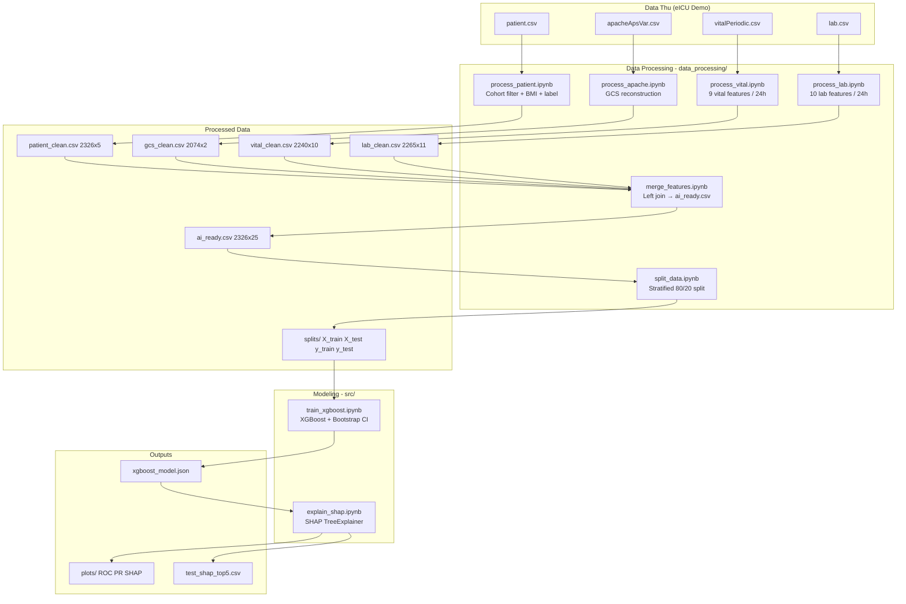

# ICU Mortality Prediction

> Dự đoán nguy cơ tử vong bệnh nhân ICU trong 24 giờ đầu nhập viện  
> sử dụng XGBoost + SHAP Explainability trên bộ dữ liệu eICU Demo v2.0.1.

---

## 1. Giới thiệu dự án

### Bài toán & Động lực

Mỗi năm, hàng triệu bệnh nhân nhập Khoa Điều trị tích cực (ICU). Quyết định phân
bổ nguồn lực y tế — máy thở, giường hồi sức, nhân lực — đòi hỏi bác sĩ phải đánh giá
nhanh chóng nguy cơ tử vong của từng bệnh nhân. Hiện tại, hầu hết các hệ thống cảnh báo
sớm chỉ cung cấp con số rủi ro mà không giải thích lý do, khiến bác sĩ khó tin tưởng và
áp dụng vào thực tế lâm sàng.

Dự án này tái hiện kết quả từ bài báo khoa học:

> *"Standalone LLM and a Pre-specified Agentic Pipeline for Explaining ICU Mortality
> Predictions: a Feasibility Study on the eICU Demo Dataset"*

bằng cách xây dựng toàn bộ pipeline từ dữ liệu thô đến mô hình có khả năng **giải
thích từng dự đoán** cho bác sĩ lâm sàng.

### Mục tiêu

| Mục tiêu | Chi tiết |
|-----------|----------|
| **Dự đoán** | Phân loại nhị phân: bệnh nhân ICU tử vong (`1`) hay sống (`0`) |
| **Giải thích** | Dùng SHAP để xác định top-5 đặc trưng quyết định nhất với từng bệnh nhân |
| **Tái lập** | Reproduce kết quả AUROC ~0.855 từ bài báo gốc |
| **Nền tảng** | Cung cấp `test_shap_top5.csv` cho bước LLM/Agentic pipeline tiếp theo |

### Đối tượng & Phạm vi

- **Dữ liệu:** eICU Demo v2.0.1 (phiên bản demo công khai, 2.326 bệnh nhân người lớn)
- **Cửa sổ quan sát:** 24 giờ đầu tiên nhập ICU
- **Phạm vi:** Nghiên cứu khả năng (feasibility study), không phải sản phẩm lâm sàng

---

## 2. Tính năng nổi bật

- **Pipeline đầy đủ:** Từ dữ liệu thô eICU → làm sạch → feature engineering → huấn luyện → đánh giá → giải thích
- **XGBoost với `scale_pos_weight`:** Xử lý mất cân bằng nhãn nghiêm trọng (8.21% tử vong) không cần oversampling
- **NaN-aware design:** Giữ nguyên giá trị thiếu thay vì impute, tận dụng khả năng xử lý NaN built-in của XGBoost
- **SHAP TreeExplainer (probability space):** Giải thích dự đoán ở không gian xác suất thay vì log-odds để bác sĩ dễ hiểu
- **Bootstrap CI 95%:** Đánh giá độ tin cậy AUROC/AUPRC qua 1.000 lần bootstrap
- **Data Quality Module:** `data_quality.py` — bộ hàm kiểm tra chất lượng tái sử dụng (plausibility, sentinel, distribution, logic)

---

## 3. Technology Stack

| Công nghệ | Phiên bản | Vai trò trong dự án |
|-----------|-----------|----------------------|
| **Python** | 3.x | Ngôn ngữ chính toàn bộ pipeline |
| **pandas** | >= 2.0.0 | Đọc, lọc, transform dữ liệu dạng bảng; groupby aggregate đặc trưng |
| **numpy** | >= 1.24.0 | Tính toán vector; bootstrap sampling |
| **XGBoost** | >= 2.0.0 | Mô hình dự đoán chính; gradient boosted trees |
| **scikit-learn** | >= 1.3.0 | `train_test_split` stratify; metrics (AUROC, AUPRC, ROC curve) |
| **SHAP** | >= 0.42.0 | TreeExplainer, summary plot, waterfall plot, top-5 feature extraction |
| **LightGBM** | >= 4.0.0 | Có trong dependencies (thực nghiệm so sánh — chưa triển khai) |
| **matplotlib** | >= 3.7.0 | Vẽ ROC curve, PR curve, biểu đồ bootstrap |
| **seaborn** | >= 0.12.0 | Hỗ trợ styling biểu đồ |
| **joblib** | >= 1.3.0 | Lưu/nạp model checkpoint |
| **pyarrow** | >= 14.0.0 | Hỗ trợ định dạng Parquet (tùy chọn) |
| **Jupyter Notebook** | — | Môi trường phát triển tương tác cho toàn bộ pipeline |

---

## 4. Kiến trúc hệ thống



---

## 5. Cấu trúc thư mục

```
ICU_Mortality_Prediction/
│
├── data/
│   ├── raw/
│   │   ├── challenge2012/          # Dữ liệu PhysioNet 2012 Challenge (tham khảo)
│   │   └── eicu/                   # 4 file CSV gốc eICU Demo v2.0.1
│   │       ├── patient.csv         # Nhân khẩu, nhãn mortality (2520 dòng)
│   │       ├── apacheApsVar.csv    # Chỉ số APACHE – nguồn GCS
│   │       ├── vitalPeriodic.csv   # Sinh hiệu 5 phút/lần (~1.6M dòng)
│   │       └── lab.csv             # Xét nghiệm dạng dọc (~24.7MB)
│   │
│   ├── processed/                  # Dữ liệu đã làm sạch
│   │   ├── patient_clean.csv       # 2326 × 5
│   │   ├── gcs_clean.csv           # 2074 × 2
│   │   ├── vital_clean.csv         # 2240 × 10
│   │   ├── lab_clean.csv           # 2265 × 11
│   │   └── ai_ready.csv            # 2326 × 25 (dataset huấn luyện)
│   │
│   ├── splits/                     # Train/test splits
│   │   ├── X_train.csv  (1860 × 23)
│   │   ├── X_test.csv   (466 × 23)
│   │   ├── y_train.csv  (1860,)
│   │   └── y_test.csv   (466,)
│   │
│   ├── quality_checks/             # Kiểm soát chất lượng dữ liệu
│   │   ├── data_quality.py         # ★ Module Python tái sử dụng
│   │   ├── patient_quality.ipynb
│   │   ├── gcs_quality.ipynb
│   │   ├── vital_quality.ipynb
│   │   └── lab_quality.ipynb
│   │
│   └── explore_data/               # EDA notebooks
│
├── data_processing/                # Pipeline xử lý dữ liệu
│   ├── process_patient.ipynb       # Bước 1: Xử lý patient.csv
│   ├── process_apache.ipynb        # Bước 2: Trích xuất GCS
│   ├── process_vital.ipynb         # Bước 3: Aggregate sinh hiệu
│   ├── process_lab.ipynb           # Bước 4: Aggregate xét nghiệm
│   ├── merge_features.ipynb        # Bước 5: Hợp nhất → ai_ready.csv
│   └── split_data.ipynb            # Bước 6: Stratified split
│
├── src/                            # Modeling notebooks
│   ├── train_xgboost.ipynb         # ★ Huấn luyện + đánh giá + Bootstrap CI
│   └── explain_shap.ipynb          # ★ SHAP explainability + top-5 export
│
├── models/
│   └── xgboost_model.json          # Model đã huấn luyện (XGBoost native format)
│
├── outputs/
│   ├── plots/                      # Biểu đồ đánh giá và SHAP
│   │   ├── xgboost_evaluation.png  # ROC + PR curve + Bootstrap distributions
│   │   ├── shap_summary_beeswarm.png
│   │   ├── shap_summary_bar.png
│   │   └── shap_waterfall_patient_172015.png
│   └── test_shap_top5.csv          # Top-5 SHAP features cho từng bệnh nhân test
│
├── document/
│   ├── DATA_PROCESSING.md          # Tài liệu chi tiết pipeline xử lý dữ liệu
│   └── references/                 # Bài báo tham khảo gốc (PDF)
│
├── requirements.txt                # Dependencies
└── README.md                       # Tài liệu này
```

---

## 6. Cài đặt & Chạy dự án

### Yêu cầu môi trường

- Python >= 3.9
- Jupyter Notebook / JupyterLab
- Dữ liệu eICU Demo v2.0.1 (tải từ [PhysioNet](https://physionet.org/content/eicu-crd-demo/))

### Cài đặt dependencies

```bash
# Tạo virtual environment
python -m venv .venv
source .venv/bin/activate   # Linux/macOS
# .venv\Scripts\activate    # Windows

# Cài đặt packages
pip install -r requirements.txt
```

### Cấu hình dữ liệu

Đặt 4 file dữ liệu eICU vào đúng vị trí:

```
data/raw/eicu/
├── patient.csv
├── apacheApsVar.csv
├── vitalPeriodic.csv
└── lab.csv
```

### Chạy pipeline theo thứ tự

```bash
jupyter notebook
```

| Bước | Notebook | Output |
|------|----------|--------|
| 1 | `data_processing/process_patient.ipynb` | `patient_clean.csv` |
| 2 | `data_processing/process_apache.ipynb` | `gcs_clean.csv` |
| 3 | `data_processing/process_vital.ipynb` | `vital_clean.csv` |
| 4 | `data_processing/process_lab.ipynb` | `lab_clean.csv` |
| 5 | `data_processing/merge_features.ipynb` | `ai_ready.csv` |
| 6 | `data_processing/split_data.ipynb` | `X_train/test`, `y_train/test` |
| 7 | `src/train_xgboost.ipynb` | `xgboost_model.json`, plots |
| 8 | `src/explain_shap.ipynb` | `test_shap_top5.csv`, SHAP plots |

---

## 7. Hướng dẫn sử dụng

### Chạy kiểm tra chất lượng dữ liệu

```python
import sys
sys.path.append("data/quality_checks")
from data_quality import audit
import pandas as pd

df = pd.read_csv("data/processed/patient_clean.csv")
audit(df, name="patient_clean.csv")
```

### Nạp lại model để dự đoán

```python
from xgboost import XGBClassifier
import pandas as pd

model = XGBClassifier()
model.load_model("models/xgboost_model.json")

X_test = pd.read_csv("data/splits/X_test.csv")
y_pred_proba = model.predict_proba(X_test)[:, 1]
# y_pred_proba[i] = xác suất tử vong của bệnh nhân i
```

### Đọc kết quả SHAP

```python
df_shap = pd.read_csv("outputs/test_shap_top5.csv")
# Mỗi dòng: 1 bệnh nhân + y_true + y_pred_proba + top-5 features & SHAP values
# Cột: patientunitstayid, y_true, y_pred_proba,
#       shap_top1_name, shap_top1_value, shap_top1_feature, ...
```

---

## 8. Kết quả & Thành tựu

### Kết quả đánh giá trên tập test (466 bệnh nhân)

| Metric | Dự án này | Bài báo gốc |
|--------|-----------|-------------|
| **AUROC** | ~0.855 | 0.855 (CI: 0.796–0.906) |
| **AUPRC** | ~0.332 | 0.332 (CI: 0.217–0.494) |
| **Bootstrap lần** | 1.000 | 1.000 |

> *Tỷ lệ tử vong tập test: ~8.2% (38/466) → baseline AUPRC = 0.082*  
> *AUROC = 0.855 >> 0.5 (random) và AUPRC = 0.332 >> 0.082 (naive) chứng minh mô hình học được tín hiệu có giá trị.*

### Dataset cuối (ai_ready.csv)

| Thông số | Giá trị |
|----------|---------|
| Tổng bệnh nhân (cohort) | 2.326 |
| Alive (0) | 2.135 (91.79%) |
| Expired (1) | 191 (8.21%) |
| Số đặc trưng | 23 |
| Train / Test | 1.860 / 466 (80/20 stratified) |

### Hyperparameter XGBoost

| Tham số | Giá trị | Lý do |
|---------|---------|-------|
| `n_estimators` | 100 | Đủ cho dataset nhỏ, không overfit |
| `max_depth` | 3 | Shallow trees → tránh overfit, giữ interpretability |
| `learning_rate` | 0.05 | Learning rate thấp → ổn định |
| `scale_pos_weight` | ~11.16 | Bù mất cân bằng: 1707/153 |
| `eval_metric` | logloss | Phù hợp binary classification |

---

## 9. Hạn chế & Hướng phát triển

### Hạn chế hiện tại

- **Dữ liệu demo nhỏ:** eICU Demo chỉ có ~2.300 bệnh nhân (toàn bộ eICU-CRD có ~200.000); kết quả có thể không khái quát tốt
- **Không tuning hyperparameter:** Sử dụng hyperparameter cố định theo bài báo gốc, chưa GridSearch/Optuna
- **LightGBM chưa so sánh:** Có trong `requirements.txt` nhưng chưa được triển khai trong notebook
- **Không có cross-validation:** Chỉ dùng 1 lần split 80/20
- **Dữ liệu thiếu nhiều:** Một số đặc trưng (lactate ~79%, temperature ~93%) rất thưa

### Hướng phát triển

- [ ] Mở rộng sang eICU-CRD đầy đủ hoặc MIMIC-IV
- [ ] Hyperparameter tuning với Optuna
- [ ] So sánh XGBoost vs LightGBM vs Random Forest
- [ ] Cross-validation k-fold cho đánh giá ổn định hơn
- [ ] Tích hợp LLM/Agentic pipeline để tự động sinh giải thích lâm sàng từ SHAP
- [ ] Xây dựng REST API để phục vụ real-time prediction
- [ ] Thêm calibration (Platt Scaling / Isotonic Regression) cho xác suất đầu ra

---

## 10. Tài liệu tham khảo

### Bài báo chính

- *"Standalone LLM and a Pre-specified Agentic Pipeline for Explaining ICU Mortality Predictions: a Feasibility Study on the eICU Demo Dataset"* — xem file PDF tại `document/references/`

### Dataset

- [eICU Collaborative Research Database Demo v2.0.1](https://physionet.org/content/eicu-crd-demo/) — PhysioNet

### Tài liệu công nghệ

- [XGBoost Documentation](https://xgboost.readthedocs.io/) — `scale_pos_weight`, native JSON format
- [SHAP Documentation](https://shap.readthedocs.io/) — TreeExplainer, probability space
- [scikit-learn: train_test_split](https://scikit-learn.org/stable/modules/generated/sklearn.model_selection.train_test_split.html) — stratified split
- [APACHE Score / GCS](https://www.mdcalc.com/calc/1217/apache-ii-score) — Glasgow Coma Scale components
- [eICU-CRD Paper](https://www.nature.com/articles/sdata2018178) — Pollard et al., 2018, *Scientific Data*
